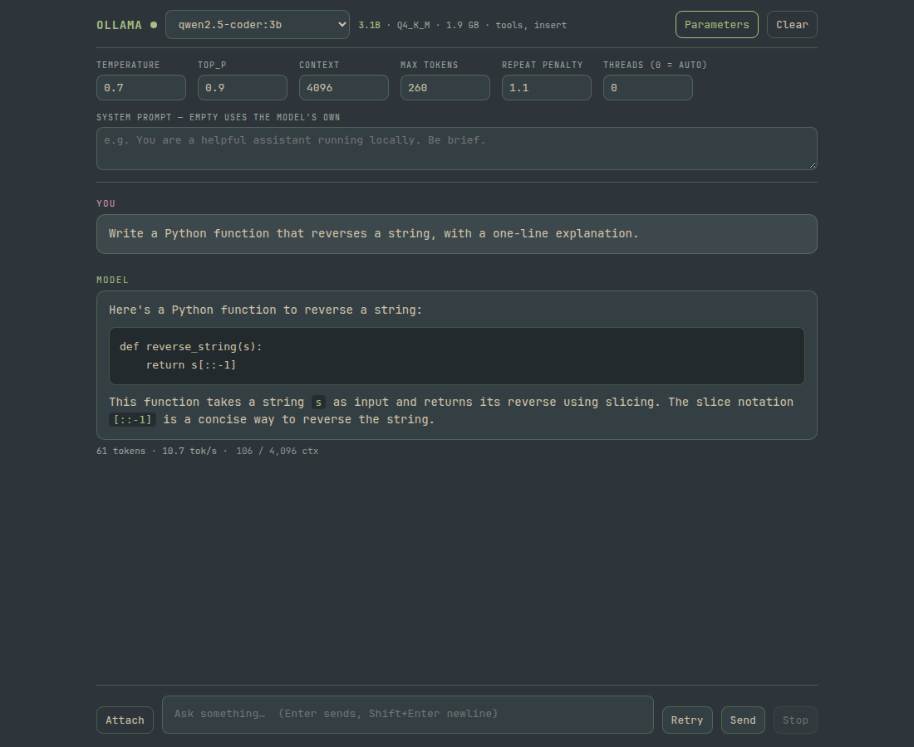

# ollama-web

A small, dependency-free chat interface for a local [Ollama](https://ollama.com)
server — one HTML file, no build step, no CDN, no framework.



Ollama ships a CLI and an HTTP API but no web UI. This fills that gap with a
single page that talks straight to `http://127.0.0.1:11434`, plus a ~170 line
Python server whose only job is to turn PDFs and images into text so they can
be attached to a prompt.

## Features

- **Streaming chat** against `/api/chat`, with a live cursor and Stop (`Esc`).
- **Thinking models.** Handles both shapes Ollama returns: a separate
  `message.thinking` field, and inline ` thinking…</think>` text inside
  `message.content` (which is what raw GGUF imports produce). Collapsed by
  default, char count in the summary.
- **Markdown** — fenced code, inline code, headings, ordered/unordered lists,
  blockquotes, rules, bold, italic, links. Everything is escaped before
  rendering, so a model reply cannot inject markup.
- **Copy button** on every code block.
- **Attachments** — plain text and source files are read in the browser; PDFs
  and images go through the local server (`pdftotext`, `tesseract`), with an
  OCR fallback for scanned PDFs. Nothing leaves the machine.
- **Parameter panel** — temperature, top_p, context, max tokens, repeat
  penalty, thread count, system prompt. Persisted in `localStorage`.
- **Model info** — parameter count, quantisation, size and capabilities shown
  next to the picker, read from `/api/show`.
- **Retry** — ask the same question again, replacing the previous answer.
- **Context meter** — prompt + generated tokens against `num_ctx`, so a full
  window is visible before the oldest turns start dropping.

## Install

```bash
git clone https://github.com/beav0team/ollama-web.git
cd ollama-web
./install.sh
```

That symlinks `omarchy-ai-server` and `omarchy-ai-widget` into `~/.local/bin`.
Nothing else is installed and no service is enabled — the launcher starts the
page server on demand.

**Requirements:** `python3`, and `ollama` running on `127.0.0.1:11434`.
Optional: `poppler-utils` (`pdftotext`, `pdftoppm`) and `tesseract` for PDF and
image attachments. The launcher uses Brave as a Chromium app window; any
Chromium-based browser works if you change one line.

## Usage

```bash
omarchy-ai-widget        # opens (or focuses) the chat window
```

On the Hyprland setup this is bound to `SUPER + A`, and the window is an
ordinary tiled window — no floating popup, no titlebar to fight with.

Environment variables for the server:

| variable | default | meaning |
|---|---|---|
| `OMARCHY_AI_PORT` | `8099` | port to serve the page on |
| `OMARCHY_AI_ROOT` | repo root | directory to serve |

## Gotcha: Ollama has two model stores

This cost an afternoon, so it is written down. If a model works in the CLI but
never appears in the UI, you are probably looking at two different stores:

```bash
# what the service is serving
systemctl show ollama -p User        # User=ollama
# -> its store is /usr/share/ollama/.ollama/models

# what your shell imported into when the service was not running
ls ~/.ollama/models/manifests       # -> your own store
```

A model imported while the service was down lands in `~/.ollama/models` and is
invisible to the running daemon. The fix is to create it against the service:

```bash
ollama create <name> -f Modelfile   # no OLLAMA_HOST override
ollama list                         # now it shows up
```

## Note: importing a raw GGUF

`ollama create` does **not** use the chat template embedded in a GGUF. It falls
back to `{{ .Prompt }}`, and the model will ramble instead of answering. Supply
the template yourself:

```
FROM /path/to/model.gguf
TEMPLATE """{{- if .System }}<|im_start|>system
{{ .System }}<|im_end|>
{{ end }}{{- range .Messages }}<|im_start|>{{ .Role }}
{{ .Content }}<|im_end|>
{{ end }}<|im_start|>assistant
"""
PARAMETER num_ctx 4096
PARAMETER num_thread 8
```

Verify with `curl -s localhost:11434/api/show -d '{"model":"<name>"}'` — a
template of about 13 characters means the fallback was used.

## Performance, measured

A 9B model at IQ3_S (4.37 GB) on an i5-8350U with 8 GB RAM and no GPU:

| config | generation |
|---|---|
| `num_ctx 2048` | 0.8 tok/s |
| `num_ctx 4096` | 0.8 tok/s |
| `num_ctx 4096`, `num_thread 8` | **1.3 tok/s** |
| `num_ctx 8192` | 1.5 tok/s, 5.9 GB peak |

Thread count is the setting that matters — Ollama defaults to physical cores.
Context size barely moves the speed on hybrid-attention models but costs
memory, so 4096 is the sweet spot at 8 GB.

## License

No license file yet — ask the author before redistributing.
